# Auvrion Biosphere

### Environmental Intelligence Platform for Biodiversity Conservation and Forest Fire Risk Monitoring

**AI-Assisted Bioacoustics | IoT Monitoring | WebGIS | Environmental Risk Intelligence**

Developed by **Team Pais Patin** for the **UINIC 8.0 Web Development Competition 2026**.

Auvrion Biosphere is a web-based environmental intelligence platform designed to connect biodiversity monitoring, environmental observations, geospatial information, and human-operated field verification into a unified operational workflow.

The platform combines IoT-based acoustic observations, AI-assisted bioacoustic analysis, satellite environmental data, and role-based collaboration to support more transparent, traceable, and evidence-based environmental monitoring.

**Core principle: IoT observes. AI assists. Humans verify and decide.**

> Auvrion Biosphere is an evolving competition prototype. Satellite anomalies, AI predictions, and simulated observations do not independently establish verified environmental incidents or wildlife identification.

---

## Table of Contents

- [Overview](#overview)
- [Key Features](#key-features)
- [Application Preview](#application-preview)
- [IoT Hardware Prototype](#iot-hardware-prototype)
- [Operational Workflow](#operational-workflow)
- [System Architecture](#system-architecture)
- [Technology Stack](#technology-stack)
- [Getting Started](#getting-started)
- [Quality Assurance](#quality-assurance)
- [Security and Data Integrity](#security-and-data-integrity)
- [Project Structure](#project-structure)
- [Documentation](#documentation)
- [Current Limitations](#current-limitations)
- [Development Team](#development-team)
- [License](#license)

---

## Overview

Environmental monitoring frequently involves disconnected data sources, manual reporting processes, uncertain observations, and limited coordination between monitoring personnel and field teams.

Auvrion Biosphere addresses these challenges through an integrated environmental monitoring and operational management platform.

The system supports two primary monitoring domains:

| Domain | Description |
|---|---|
| **LISTEN** | Acoustic monitoring and AI-assisted bioacoustic observation analysis |
| **PREVENT** | Environmental risk monitoring using satellite references, air-quality information, and human observations |

Both domains use a shared observation and verification workflow.

Auvrion Biosphere connects:

- Environmental observations and their source metadata.
- IoT LISTEN device recording and ingestion.
- AI-assisted acoustic analysis.
- NASA FIRMS satellite thermal anomaly references.
- Air-quality information displayed using the US AQI scale.
- Spatial visualization through WebGIS.
- Human review, operational assignments, and field evidence.
- Auditable Case and Task histories.

The platform is designed around the principle that environmental observations should be evaluated according to their source, quality, uncertainty, and available supporting evidence.

---

## Key Features

### Environmental Intelligence

- Satellite hotspot visualization using NASA FIRMS reference data.
- Air-quality information and US AQI visualization.
- Spatial monitoring using an interactive WebGIS interface.
- Environmental-risk observation intake.
- Observation provenance and source attribution.
- Distinction between environmental indicators and confirmed incidents.

### Bioacoustic Intelligence

- IoT LISTEN acoustic observation integration.
- Audio recording metadata and evidence management.
- Authorized WAV playback and audio review.
- AI-assisted analysis using bioacoustic model outputs.
- Human interpretation of acoustic evidence.
- Traceable observation and analysis records.

### Operational Management

- Role-based Operator, Supervisor, and Ranger workspaces.
- Observation intake and review.
- Case creation and operational handoff.
- Supervisor decisions and Ranger assignments.
- Field findings and supporting evidence.
- Case and Task history.
- Operational analytics and monitoring interfaces.

### Platform Security

- Authentication and organization-scoped authorization.
- Multi-factor authentication.
- Account and session security workflows.
- Administrative identity and device management.
- Private media access controls.
- Device ingestion authentication.
- Evidence integrity verification.

---

# Application Preview

The following screenshots illustrate the principal operational interfaces of Auvrion Biosphere.

The screenshots are taken from the development environment and may contain demonstration data.

## 1. Operator Dashboard

The Operator Dashboard provides an overview of environmental monitoring activities, observations, operational information, and items requiring attention.

Operators can review incoming information, inspect supporting evidence, and initiate observation-related workflows.

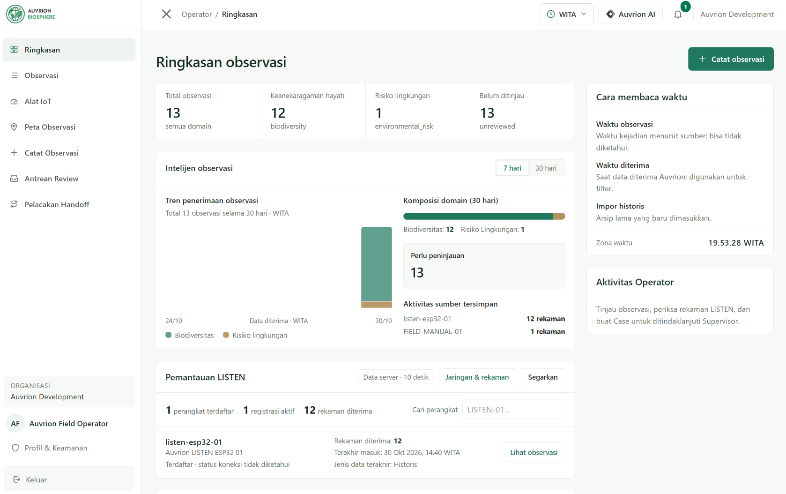

---

## 2. Environmental Intelligence WebGIS

Auvrion Biosphere uses MapLibre GL JS to visualize spatial observations and environmental reference information.

### 2.1 NASA FIRMS Satellite Hotspot Monitoring

The satellite hotspot interface visualizes thermal anomalies reported through NASA FIRMS.

These observations provide situational awareness about potentially unusual thermal activity across supported geographical regions.

Displayed reference attributes may include:

- Satellite or instrument source.
- Acquisition date and time.
- Geographic coordinates.
- Fire Radiative Power (FRP), where available.
- Brightness temperature.
- Satellite confidence metadata.

**Important:** A satellite hotspot represents a detected thermal anomaly, not an independently confirmed forest fire.

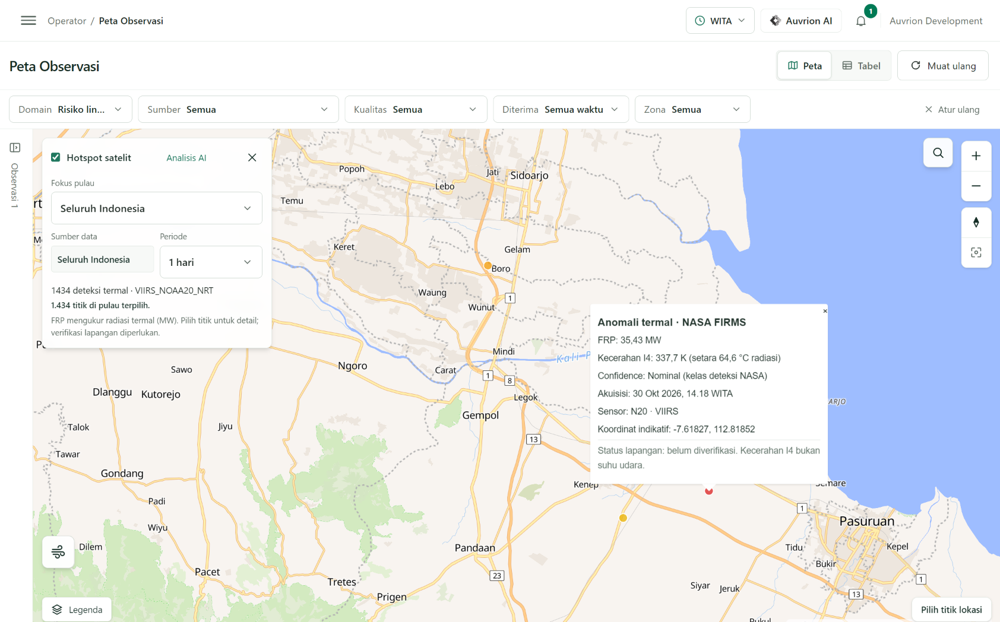

### 2.2 Air Quality Monitoring — US AQI

The air-quality interface presents environmental air-quality information using the United States Air Quality Index (US AQI) scale.

This information supports environmental awareness and provides context for monitoring activities.

Air-quality values depend on the configured external provider, available observations or estimates, and geographic coverage.

They must not be represented as direct measurements from the physical PREVENT device.

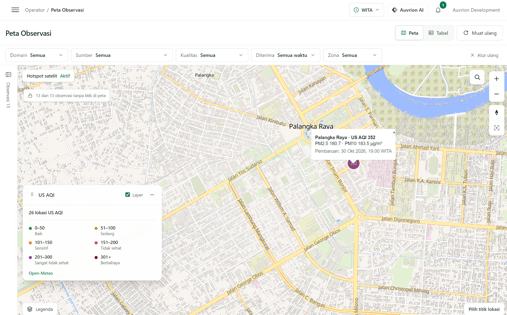

---

## 3. Bioacoustic Monitoring and Analysis

Auvrion Biosphere supports acoustic evidence review and AI-assisted interpretation.

Audio evidence and model-generated analysis results are displayed separately to preserve the distinction between recorded observations and inferred information.

### 3.1 Acoustic Evidence and Audio Review

The audio review interface enables authorized users to inspect available bioacoustic evidence and recording metadata.

Depending on the selected recording and interface capabilities, the workspace may provide audio playback and audio visualization.

This process supports human inspection before an observation is escalated for further operational review.

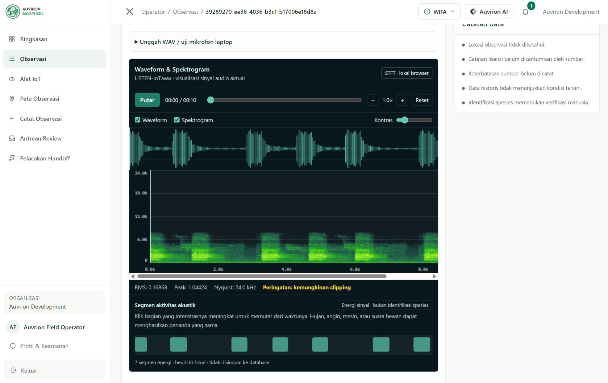

### 3.2 AI-Assisted Bioacoustic Analysis

The AI bioacoustic analysis interface displays candidate interpretations generated from acoustic recordings.

Auvrion uses the Perch bioacoustic model integration to assist in identifying potentially relevant acoustic patterns.

Model-generated classifications or similarity results are treated as supporting information, not independently verified species identification.

Human review remains necessary to interpret:

- Candidate labels.
- Available model scores.
- Acoustic quality and background noise.
- Observation context.
- Uncertainty and possible false positives.

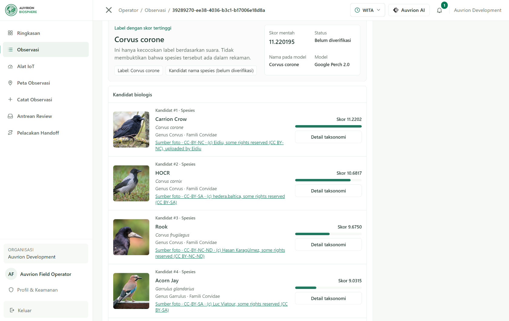

---

## 4. IoT LISTEN Monitoring

The LISTEN monitoring workspace provides an interface for managing acoustic monitoring activities and reviewing information associated with registered LISTEN devices.

The platform supports authenticated device recording ingestion and associated evidence records.

Device connectivity and operational status must be interpreted according to available ingestion, diagnostic, and monitoring evidence.

A stored recording alone does not prove that a device is currently online.


---

## 5. Supervisor Workspace

Supervisors coordinate operational decisions, review submitted Cases, and manage Ranger assignments.

### 5.1 Supervisor Dashboard

The Supervisor Dashboard presents operational summaries and monitoring information to support review and coordination.


### 5.2 Case Management and Operational Decisions

The Case Management interface supports review of observations submitted by Operators.

Supervisors can examine available evidence and uncertainty, determine whether additional investigation is necessary, and assign appropriate follow-up work.

Where applicable, the system records operational transitions and associated history.


---

## 6. Ranger Field Operations

Rangers perform assigned verification activities and document relevant field observations.

The Ranger workspace provides access to authorized assignments and supports the reporting of field findings.

### 6.1 Task Assignment Overview

The Task Assignment interface displays the operational information associated with an assigned task.

This may include:

- Assignment title and status.
- Supervisor instructions.
- Related observation context.
- Available supporting evidence.
- Required verification activities.

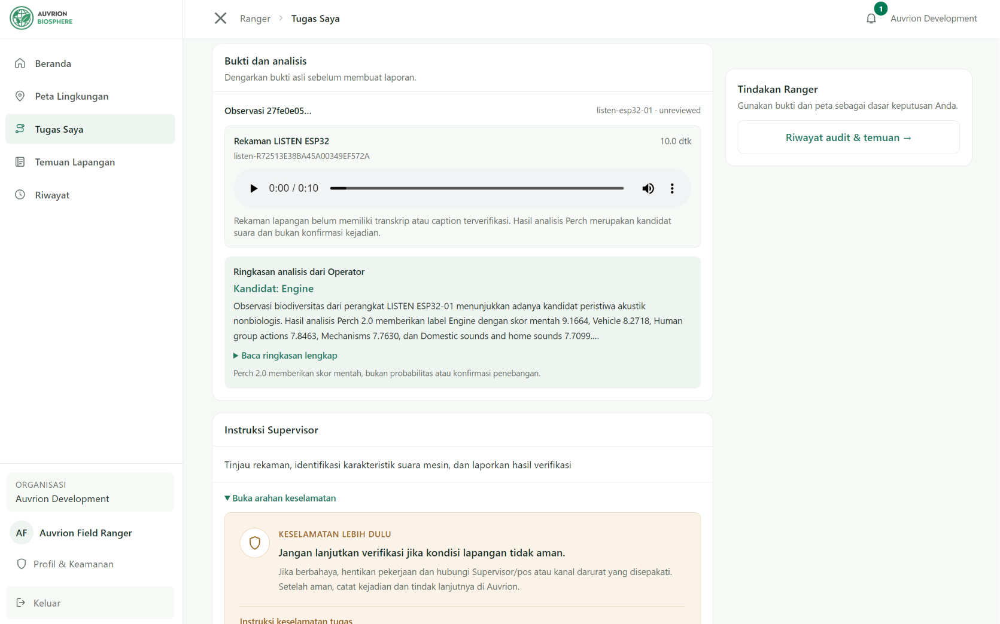

### 6.2 Task Location and Spatial Context

The Ranger task interface provides geographical context for field assignments using available authorized location information.

The embedded map helps Rangers understand the area associated with an operational task.

The displayed location must be interpreted according to its original source and disclosure permissions.

A device installation point, observation coordinate, or satellite hotspot must not automatically be interpreted as the exact location of an animal or a confirmed incident.

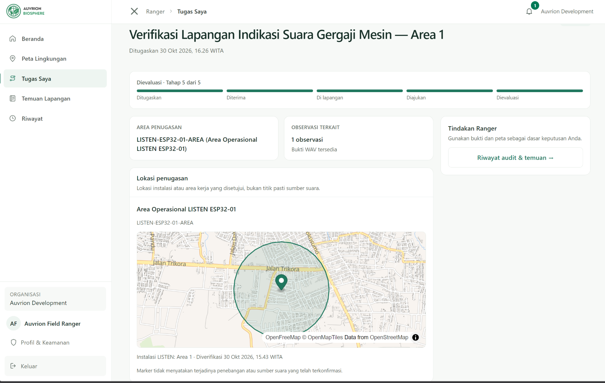

### 6.3 Field Findings and Evidence

After conducting an assigned verification activity, Rangers can document findings and attach supporting evidence through authorized workflows.

Submitted information may include:

- Field observations.
- Verification outcomes.
- Supporting photographs.
- Relevant notes.
- Task history and submission status.

Supervisor review remains part of the operational decision process.

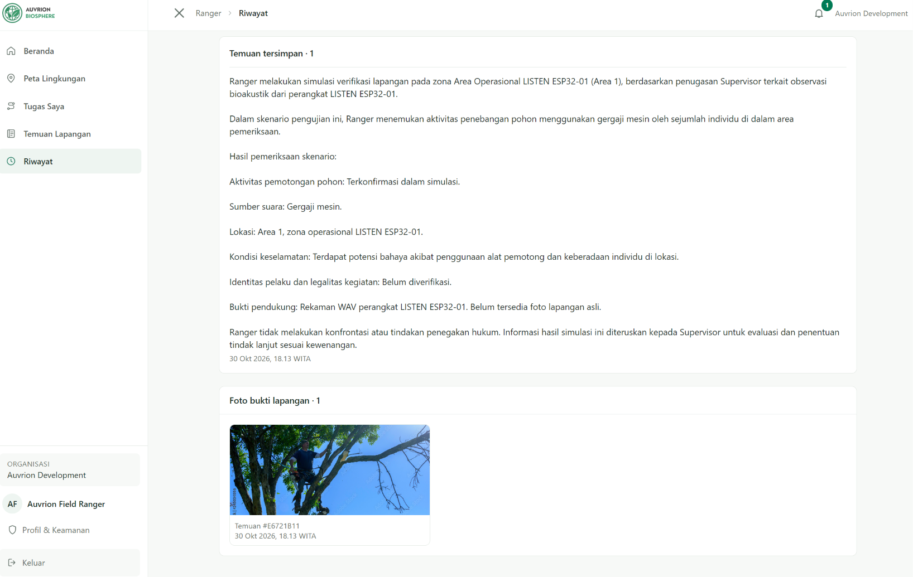

---

## 7. Administrative Device Management

The administrative workspace supports authorized management of LISTEN device records and associated operational configuration.

Administrative actions are distinct from normal Operator, Supervisor, and Ranger capabilities.

Device-related operations must preserve organization boundaries, credential security, and auditable configuration changes.

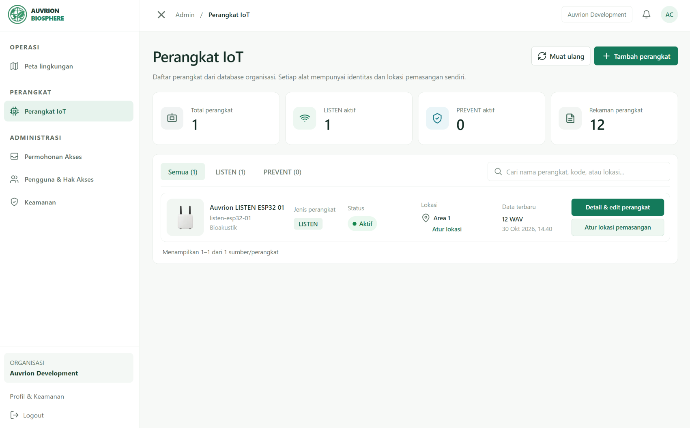

---

## 8. Environmental Risk Observation Intake

Auvrion Biosphere supports manual environmental-risk observations with source attribution and contextual information.

The observation process distinguishes:

- Human-reported environmental conditions.
- Satellite-derived reference information.
- Historical observations.
- Simulated demonstration records.
- Actual device measurements, when supported by a verified ingestion pipeline.

This distinction helps prevent environmental reference information from being incorrectly represented as physical sensor evidence.


---

## 9. Profile and Security

The Profile and Security workspace provides account-related information and security controls for authorized users.

The platform includes authentication and security workflows designed to support identity verification and controlled operational access.

Security capabilities include MFA-related controls and account session management.

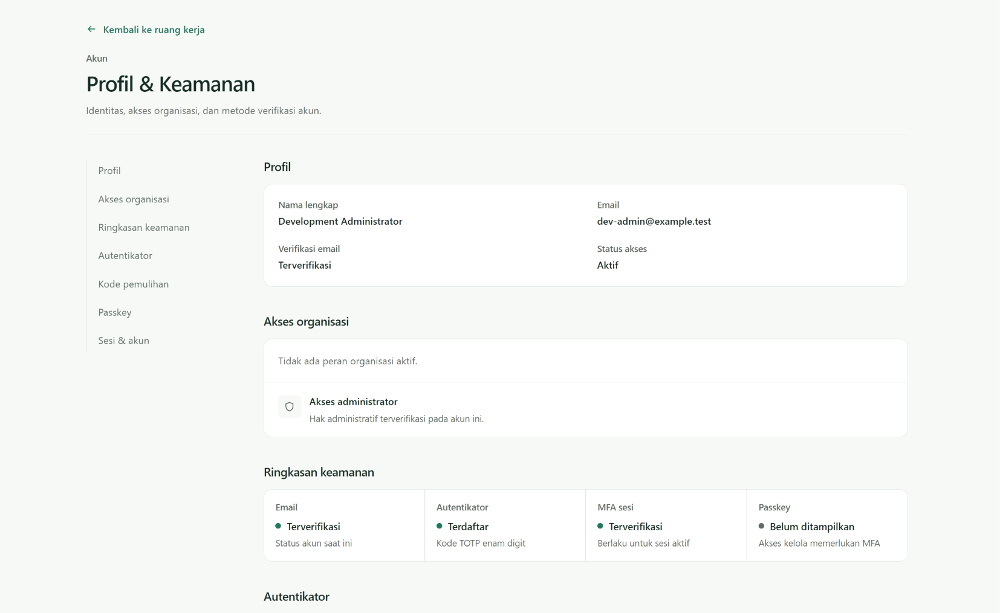

---

# IoT Hardware Prototype

## LISTEN — Acoustic Monitoring Device

LISTEN is the physical acoustic monitoring component of Auvrion Biosphere.

The prototype is based on an ESP32 microcontroller and supporting components for acoustic capture and local recording.

### Physical Prototype


### Hardware Assembly


### Prototype Components

| Component | Purpose |
|---|---|
| ESP32 development board | Main microcontroller and wireless communication |
| INMP441 I2S microphone | Acoustic signal capture |
| MicroSD module | Local recording storage |
| MicroSD card | WAV file storage |
| DS3231 RTC module | Timekeeping support |
| Breadboard and jumper wires | Prototype wiring |
| USB power connection | Development and testing power supply |
| Protective enclosure | Physical component protection |

### Device Integration

The LISTEN firmware is developed using PlatformIO.

The application provides an authenticated recording ingestion endpoint:

```http
POST /api/device/recordings
```

The endpoint receives validated WAV recordings from authorized devices.

The ingestion protocol includes recording identifiers, timestamps, integrity metadata, and committed acknowledgments.

The backend is designed to avoid treating failed network transmissions as successfully persisted recordings.

Detailed integration requirements are documented in:

[LISTEN Firmware and Device Integration Handoff](docs/work-control/AB-WC-015-IOT-LISTEN-FIRMWARE-HANDOFF.md)

### Hardware Validation Boundary

A local prototype or successful recording ingestion test is not equivalent to completed long-term field validation.

Power reliability, environmental durability, network interruptions, storage recovery, and extended deployment performance require separate acceptance testing.

### PREVENT Hardware

Physical PREVENT sensor ingestion is deferred from the current demonstrated hardware scope.

The PREVENT software domain currently relies on supported manual observations and external environmental reference data.

NASA FIRMS and US AQI values must not be represented as measurements originating from physical PREVENT sensors.

---

# Operational Workflow

Auvrion Biosphere follows a human-controlled environmental observation workflow.

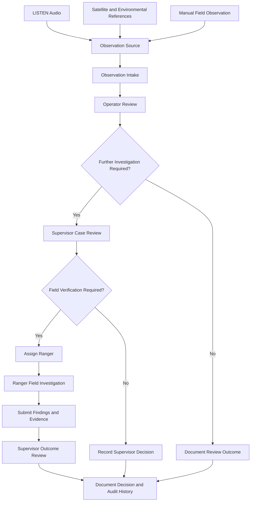

The workflow emphasizes:

1. Source-aware observation intake.
2. Human assessment of evidence and uncertainty.
3. Controlled operational handoff.
4. Field verification when appropriate.
5. Traceable decisions and supporting records.

Not every observation requires a field assignment. Operational actions depend on available evidence, role permissions, and workflow state.

---

# System Architecture

Auvrion Biosphere uses a web application architecture with database-backed identity, operational data, and geospatial functionality.

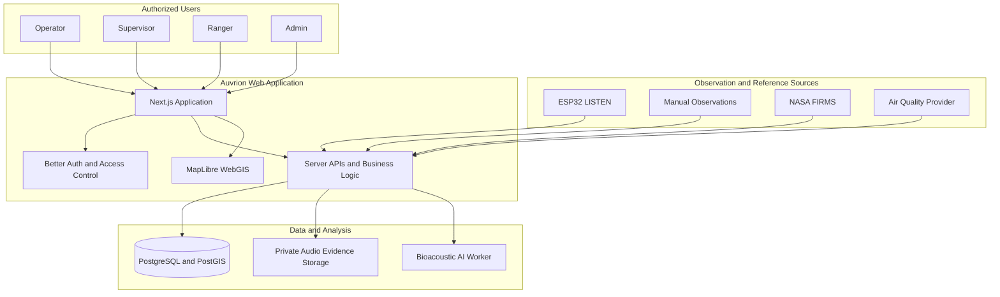

This diagram is a logical overview. Actual deployments must configure network boundaries, external provider credentials, storage persistence, and security controls separately.

---

# Technology Stack

| Layer | Technology |
|---|---|
| Full-stack framework | Next.js 16 |
| Frontend | React 19 |
| Programming language | TypeScript |
| UI styling | Tailwind CSS 4 |
| Authentication | Better Auth |
| ORM | Drizzle ORM |
| Database | PostgreSQL 16 |
| Geospatial database | PostGIS |
| Interactive maps | MapLibre GL JS |
| IoT firmware | ESP32 / PlatformIO |
| Bioacoustic analysis | Perch integration |
| Satellite environmental data | NASA FIRMS |
| Air-quality information | Configured external provider |
| Unit and integration tests | Vitest |
| Browser testing | Playwright |
| Code quality | Biome |
| Version control | Git and GitHub |

---

# Getting Started

## Prerequisites

Recommended development environment:

- Node.js 24
- npm
- PostgreSQL with PostGIS
- Docker, where used for local services
- Git
- Visual Studio Code

PlatformIO is additionally required for ESP32 firmware development.

## 1. Clone the Repository

```bash
git clone https://github.com/ryanazryan/auvrion-biosphere.git
cd auvrion-biosphere
```

## 2. Install Dependencies

```bash
npm ci
```

## 3. Configure Environment Variables

Create a local configuration file from the example.

```bash
cp .env.example .env.local
```

Configure the required database, authentication, private evidence storage, and applicable service credentials.

Never commit `.env.local` or real credentials.

Some features depend on external providers and require additional configuration.

## 4. Prepare the Database

Start the configured PostgreSQL/PostGIS service and apply reviewed Drizzle migrations according to the repository's development configuration.

Database changes should be applied to the intended environment only.

Do not use destructive database reset or cleanup scripts against production data.

## 5. Start the Development Server

```bash
npm run dev
```

Open:

```text
http://localhost:3000
```

The application requires authenticated access for operational workspaces.

The root route redirects authorized users to their permitted workspace.

Public self-registration does not automatically grant Admin, Operator, Supervisor, or Ranger permissions.

---

# Quality Assurance

Auvrion Biosphere uses automated checks alongside manual workflow verification.

## Code Quality

```bash
npm run lint
```

## TypeScript Validation

```bash
npm run typecheck
```

## Automated Tests

```bash
npm test
```

## Production Build

```bash
npm run build
```

## Recommended Verification Command

```bash
npm run lint && npm run typecheck && npm test && npm run build
```

Browser and database-backed tests may require separately configured services, test data, or credentials.

Successful execution of the commands above does not independently certify security, scientific accuracy, hardware reliability, or production readiness.

---

# Security and Data Integrity

Auvrion Biosphere is designed to preserve identity boundaries, operational permissions, and evidence integrity.

## Identity and Access

- Authentication through Better Auth.
- Role-based operational authorization.
- Organization-scoped access controls.
- Multi-factor authentication and session assurance.
- Separate administrative capabilities.

## Evidence Protection

- Private evidence handling.
- Authorized access to sensitive media.
- Recording metadata and integrity validation.
- Traceable observation and workflow relationships.

## IoT Communication

- Device-specific authentication.
- Recording identifiers and ingestion metadata.
- Integrity checks for WAV payloads.
- Persistence acknowledgment and retry-aware ingestion design.

## Environmental Data Integrity

The system distinguishes observed measurements, external reference data, AI-generated predictions, historical records, and simulation data.

Examples of important interpretation boundaries:

- NASA FIRMS thermal anomalies are not confirmed forest fires.
- Satellite brightness temperature is not ambient air temperature.
- US AQI data is not evidence of a physical PREVENT sensor measurement.
- AI acoustic candidates are not independently confirmed species records.
- A LISTEN installation coordinate does not necessarily identify the location of an animal.
- Simulated field verification must not be presented as an actual field investigation.

---

# Project Structure

```text
auvrion-biosphere/
├── docs/
│   ├── assets/
│   │   ├── screenshots/
│   │   └── hardware/
│   └── work-control/
├── drizzle/
├── firmware/
│   └── listen-esp32/
├── public/
├── scripts/
├── src/
│   ├── app/
│   ├── components/
│   ├── figma-operator/
│   └── server/
├── .env.example
├── package.json
└── README.md
```

The repository also contains supporting configuration, tests, migrations, and operational documentation.

---

# Documentation

Project documentation is maintained across GitHub and Notion.

| Resource | Description |
|---|---|
| [GitHub Repository](https://github.com/ryanazryan/auvrion-biosphere) | Application source code and development history |
| [Notion Project Workspace](https://app.notion.com/p/3f873f8cd499803dad23c166fd42cb2c) | Product, requirements, engineering, and governance documentation |
| [LISTEN Firmware Handoff](docs/work-control/AB-WC-015-IOT-LISTEN-FIRMWARE-HANDOFF.md) | Device ingestion protocol and integration guidance |

Internal documentation may contain planning records that precede the latest implementation.

Historical planning status should not be interpreted as current release verification without supporting repository and testing evidence.

---

# Current Limitations

Auvrion Biosphere remains under active development and validation.

The current project must not be represented as having completed all of the following without additional evidence:

- Long-term physical IoT field testing.
- Physical PREVENT sensor ingestion.
- Independently validated bioacoustic identification accuracy.
- Automatic confirmation of forest fires or other incidents.
- Production-grade infrastructure certification.
- Completed production backup and restoration acceptance.
- Comprehensive security assessment.
- Guaranteed availability of external environmental data providers.

These limitations do not prevent development demonstrations using clearly identified local, historical, or simulated observations.

---

# Development Team

**Team Pais Patin**

Developed for the **UINIC 8.0 Web Development Competition 2026**.

### Engineering

**Naufal Faiq Azryan**  
Tech Lead and Full Stack Developer

GitHub: [@ryanazryan](https://github.com/ryanazryan)

**Muhammad Satria Wiratama**  
Engineering Contributor

GitHub: [@Renz100x](https://github.com/Renz100x)

The project also involves business, financial, and presentation responsibilities within Team Pais Patin.

---

## License

Copyright © 2026 Auvrion Biosphere Contributors. All Rights Reserved.

Auvrion Biosphere is proprietary software developed by Team Pais Patin.

The source code is publicly accessible for project evaluation and portfolio purposes. No general permission is granted to copy, modify, redistribute, or commercially exploit the original project materials without authorization from the relevant copyright holders.

See [LICENSE](LICENSE) for further information.

Third-party dependencies and external datasets remain subject to their respective licenses and terms.

---

**Auvrion Biosphere — Connecting Environmental Observations, Spatial Intelligence, and Human Decisions.**
